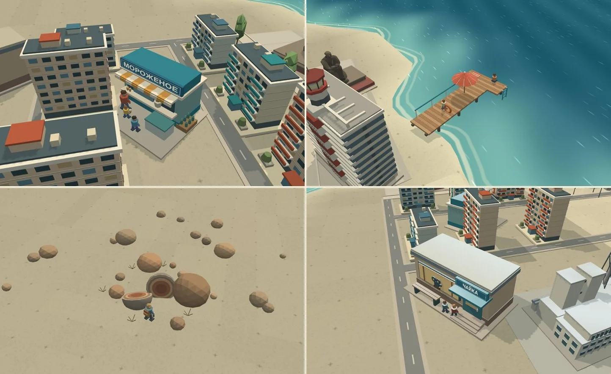
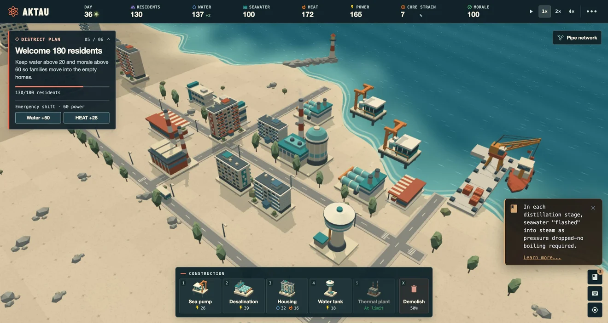
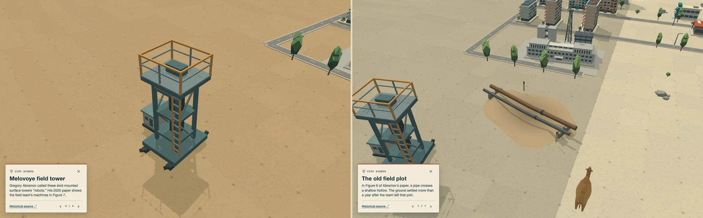
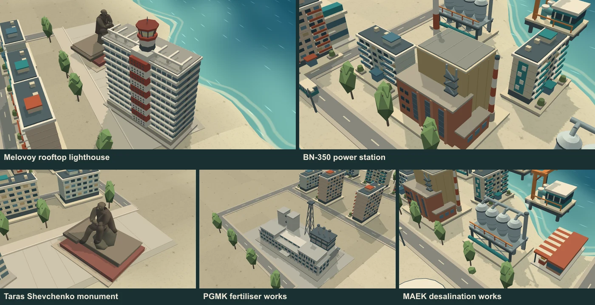

<p align="center">
  
</p>

<h1 align="center">Caspian Atom: The Aktau Protocol</h1>

<p align="center">
  <em>A Soviet-era nuclear city-builder where one reactor stands between 150,000 souls and the desert.</em>
</p>

<p align="center">
  <a href="https://aktau.eone.work/"><strong>Play Now</strong></a>
</p>

---

## The Story

**Shevchenko, Kazakh SSR, 1980s.**

In the middle of the Kazakh desert, Soviet engineers achieved the impossible: a city that shouldn't exist. No rivers. No rainfall. Just endless sand, the Caspian Sea, and one audacious idea—use a nuclear reactor to turn seawater into life.

The **BN-350 fast breeder reactor** wasn't just generating power. It was *desalinating* the sea, pumping fresh water to 150,000 people who had no business surviving there. For 27 years, this engineering marvel kept Aktau alive.

**Now it's your turn.**

---

## Gameplay

You take charge of a working waterfront with 50 residents. Click **Build housing** on the map to connect a second block to water and heat, or choose your own site from the construction menu. **Show lot** in the district plan brings the suggested site back into view. When the new residents move in, their first postcard appears in the Chronicle.

The top bar shows the day, residents and drinking water. Open **City status** for seawater, heat, power, core strain and morale. Urgent warnings appear on the map while you play.

Choose **Walk through Shevchenko** on the title screen to step into the ice-cream queue. Summer opens the wooden bathing pier in the First Microrayon, autumn brings a day trip to the stone balls at Torysh, and winter brings a backwards film screening at the Chaika courtyard club. Each outing leaves something for your album. Turn a keepsake over to write your own memory. The album stays in this browser when you start a new city.

The ice-cream and film scenes draw on [childhood memories published by Lada.kz](https://www.lada.kz/columns/12499-aktau-onischenko.html). The pier draws on [a local recollection of the first city beach in Otpan News](https://otpannews.kz/ru/news/konferentsiia-neravnodushnykh-zhiteli-aktau-podelilis-svoimi-vospominaniiami-o-kaspii). The in-game walk places these scenes on a compressed map, including the [out-of-town landscape at Torysh](https://tour-mangystau.kz/ru/destinations/torysh).





Earn the district charter by expanding both supply lines, housing 180 residents, and reaching spring on day 121. Once four blocks are connected, emergency shifts let you spend surplus power on water or heat. After the charter, choose a waterfront reed garden to save household water or district heating works to cut heat demand. Connect a fifth housing block and settle 250 residents to complete the waterfront. You can keep building in free play or host the Melovoye research team when spring arrives.

For the optional field season, connect a sixth housing block. Send the waterfront’s reserve crew inland for ten days or keep it home and let the field team finish the trial in twenty. The trial unlocks a visit to the surface tower. Return just over a game year later to see where the ground settled beneath a pipe. The crew decision is fictional. The two sights are based on [a field researcher’s published account of Melovoye](https://www.ijsred.com/volume3/issue3/IJSRED-V3I3P169.pdf).



Open **City sights** to visit the Melovoy rooftop lighthouse, the Abay Palace of Culture, the Shevchenko monument, the fertiliser works, the BN-350 reactor hall and the MAEK desalination works. Each stop includes a historical reference. The buildings share a compressed waterfront map.

At the desalination works, open the press clippings to read about the town’s water queues and the July 2023 thermal power outage. Dispatching an emergency water shift also opens a link to those clippings. The reactor hall has a separate operating record from February 1975.



Open the pipe network to check water and heat coverage independently. Select the day in the top bar to see current heat demand and the next season’s arrival.

| Challenge | Consequence |
|-----------|-------------|
| Reactor strain reaches 100% | ☢️ **Meltdown** — Game Over |
| Fresh water depleted | 🏜️ **Drought** — Game Over |
| Heat runs out in winter | ❄️ **Frozen City** — Game Over |
| Citizens unhappy | 👥 **Exodus** — Population flees |

### The Production Chain

```
    Caspian Sea
         ↓
    [Water Pump] ──→ Seawater
         ↓
    [BN-350 Reactor] ──→ Heat + Electricity
         ↓                    ↓
    [Desalination] ←──────────┘
         ↓
    Fresh Water ──→ [Microrayon Housing] ──→ Happy Citizens
```

> **Tip:** Each building has limited capacity. One distiller can only supply 2 housing blocks. Watch the ghost preview colors when placing—green means connected, gray means no capacity available!

### Buildings

| Building | What it Does |
|----------|--------------|
| **Water Pump** | Extracts seawater from the Caspian |
| **BN-350 Reactor** | The heart of the city. Generates heat & power. Working desalination plants relieve core strain. |
| **Desalination Plant** | Converts seawater → freshwater. Also cools the reactor. |
| **Microrayon Housing** | Soviet housing blocks. Needs water connection or citizens get angry. |
| **Water Tank** | Extends water distribution network. Each tank supplies 2 more housing blocks. |
| **Thermal Plant** | Supplemental heat & power. Build more as your city grows (1 per 5 housing blocks). |

### Seasons

Winter is coming. And it wants 2× the heat.

| Season | Heat Demand |
|--------|-------------|
| Spring | Normal |
| Summer | 0.5× |
| Autumn | 1.2× |
| **Winter** | **2×** |

### Economy

Expansion has a cost:

- **Scaling costs** — Each building costs 15% more than the previous of the same type
- **Maintenance** — Pumps, distillers, and thermal plants drain 1-2⚡/tick each

You can't build infinitely. Plan carefully.

---

## Controls

| Key | Action |
|-----|--------|
| `WASD` (or `ЦФЫВ`) | Pan camera |
| `Q` / `E` (or `Й` / `У`) | Rotate camera |
| Drag | Pan the map |
| Scroll or pinch | Zoom |
| `1-5` | Select building |
| `Space` | Pause/Resume |
| `M` (or `Ь`) | Mute/unmute |
| `?` | Keyboard shortcuts |
| `J` (or `О`) | Historical archive |

*All shortcuts work with both English and Russian keyboard layouts.*

---

## Quick Start

```bash
bun install
bun run dev    # http://localhost:5173
```

---

## Tech Stack

| Layer | Technology |
|-------|------------|
| Runtime | Bun |
| Build | Vite + TypeScript |
| Rendering | Babylon.js (WebGPU/WebGL) |
| Audio | ZzFX (procedural SFX) + HTML5 Audio |
| Assets | Procedural city architecture and harbor scenery, GLB ambient models |

---

## Features

- Original isometric models for the BN-350 complex, desalination lines, housing and harbor
- Separate water and heat overlays with live housing coverage
- Four seasons with changing foliage, coastal light, winter snow and heat demand
- Population growth/decline based on happiness
- Roaming camels and tumbleweeds
- Six district orders, emergency supplies and a choice of two permanent civic projects
- Historical facts about the real Aktau (20 discoverable entries)
- Save from the city controls menu and resume from the title screen
- Time controls (pause, 1×, 2×, 4×)
- **Russian & English languages** (auto-detected from browser)
- Russian keyboard layout support (WASD works as ЦФЫВ)

---

## Development

```bash
bun run dev      # Development server
bun run build    # Production build
bun run preview  # Preview build
```

---

## The Real Aktau

This game is based on the true story of **Aktau, Kazakhstan** (formerly Shevchenko). The BN-350 reactor operated from 1972 to 1999, producing both electricity and fresh water for a city built in one of the most inhospitable places on Earth.

At its peak, the reactor desalinated **120,000 cubic meters of water per day**.

[Learn more on Wikipedia →](https://en.wikipedia.org/wiki/BN-350_reactor)

---

<p align="center">
  <sub>MIT License</sub>
</p>
